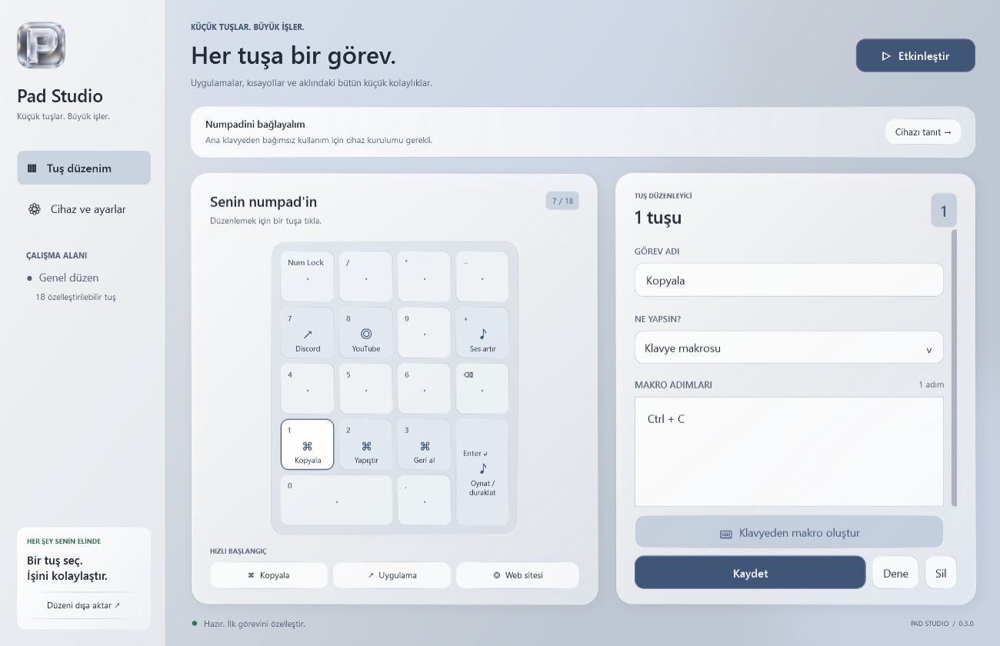
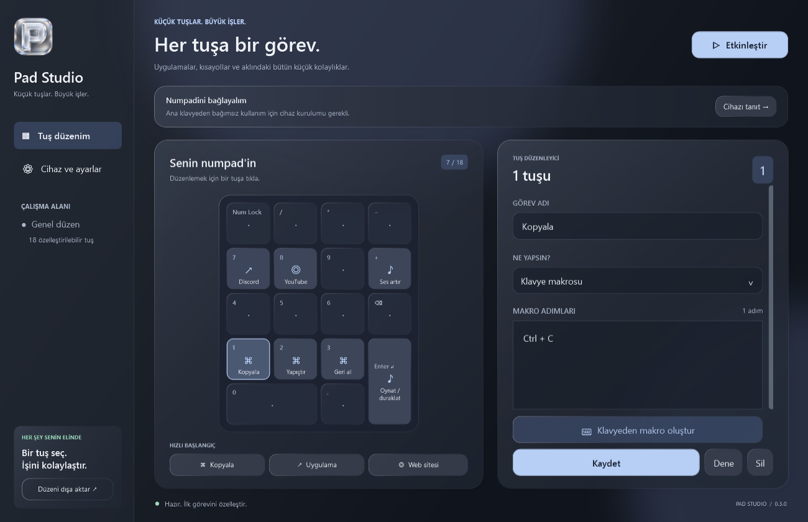
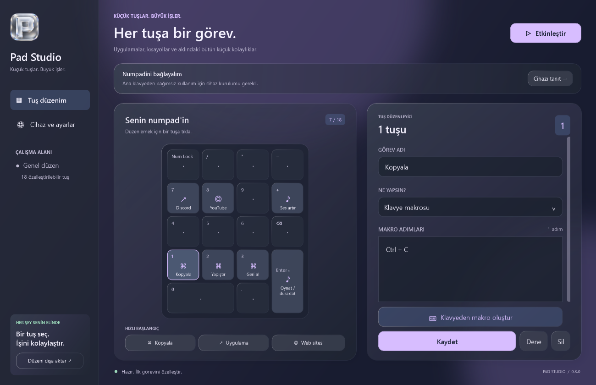

<p align="center">
  
</p>

# Pad Studio

**Numpad'in, kontrol panelin.** Harici sayısal klavyeyi makrolar, uygulama kısayolları ve medya kontrolleri için kişisel bir kumandaya dönüştüren Türkçe Windows uygulaması.


[İndir](https://github.com/ICARUS2323/Pad-Studio/releases/latest) · [Kullanım rehberi](KULLANIM.md) · [Ekran görüntüleri](docs/SCREENSHOTS.md) · [Doğrulama](docs/VALIDATION.md) · [Sorun bildir](https://github.com/ICARUS2323/Pad-Studio/issues)



## Neden geliştirildi?

Sık kullanılan kısayolları ve tekrarlanan işlemleri ayrı bir numpad üzerinden çalıştırabilmek için geliştirildi. Ana klavyeyi günlük kullanım için korurken harici numpadin tuşlarına görev atamayı sağlar. Cihaza özel ayrım için Interception sürücüsünü kullanır.

Proje; WPF masaüstü arayüzü, Windows giriş olayları, sıralı makro yürütme, cihaz eşleştirme, kalıcı kayıt ve bozuk dosyalardan kurtarma konularını bir araya getirir.

## Özellikler

| Alan | Yapabildikleri |
| --- | --- |
| Numpad düzeni | 18 fiziksel tuş için görev atama; seçilen cihazın girişlerini ana klavyeden ayırma. |
| Klavye makroları | Aynı anda veya sırayla tuş basma, bekleme ve Unicode metin adımları; görsel Türkçe klavye. |
| Uygulama ve klasör | EXE veya kısayol açma, parametre ve çalışma klasörü belirleme, klasör açma. |
| Web ve metin | Varsayılan tarayıcıda HTTP/HTTPS adresi açma, Türkçe karakterler dahil metin yazma. |
| Medya | Ses artırma/azaltma, sessiz, oynat/duraklat, sonraki ve önceki parça. |
| Görünüm | Liquid Glass Gri, Gece Camı, Aurora ve Porselen temaları. |
| Arka plan | Sistem tepsisi, duraklatma, isteğe bağlı Windows ile başlama ve otomatik etkinleşme. |
| Kayıt ve kurtarma | İki konuma kayıt, önceki sürüm yedekleri, taslak kurtarma, içe/dışa aktarma ve fabrika ayarları. |

## İndir ve çalıştır

1. [Son sürümden](https://github.com/ICARUS2323/Pad-Studio/releases/latest) **PadStudio-win-x64.zip** dosyasını indirin.
2. ZIP'i tamamen bir klasöre çıkartın; yalnızca EXE'yi taşımayın.
3. Bilgisayarınızda **.NET 10 Desktop Runtime (x64)** bulunduğundan emin olun.
4. `PadStudio/PadStudio.exe` dosyasını açın.

Hazır paket Interception DLL'i, sürücü kurucusu ve lisans metnini içerir. Sürücü uygulama açılışında kurulmaz. Kaynak kod ZIP'i çalıştırılabilir uygulamayı ve `vendor/` içeriğini kapsamaz.

## İlk cihaz kurulumu

1. **Cihaz ve ayarlar → Numpad bağlantısını test et** ile harici numpad ve ana klavyenin ayrı görüldüğünü kontrol edin.
2. **Sürücüyü kur** seçeneğini kullanın; Windows yönetici izni gerekir. Açık çalışmalarınızı kaydedip Windows'u yeniden başlatın.
3. **Cihazı tanıt** düğmesine basıp yalnızca harici numpadde **0'a bir kez** basın. Enter gerekmez; tanıtma 30 saniyede zaman aşımına uğrar.
4. Bir tuş seçin, görevini düzenleyin ve **Kaydet** düğmesine basın. Tanıtılmış numpad varsayılan olarak otomatik etkinleşir.

İlk açılışta 1, 2 ve 3 tuşlarında Kopyala, Yapıştır ve Geri al örnekleri bulunur. Etkin numpadde boş tuşlar normal karakter yazmaz. **Duraklat** ile normal tuş iletimine dönebilirsiniz.

Sürücü kurulmadan düzen hazırlama, içe/dışa aktarma ve üç saniye gecikmeli görev denemesi kullanılabilir. Fiziksel numpade özel görevler için sürücü gerekir. Interception'ın Windows 11 uyumluluğu hedef bilgisayarda ayrıca doğrulanmalıdır; uyumsuzlukta ayarlardan sürücüyü kaldırıp yeniden başlatın. Ayrıntılar ve elle kaldırma komutu [kullanım rehberinde](KULLANIM.md).

## Makro oluşturma

Bir tuş seçin → **Klavye makrosu → Klavyeden makro oluştur**.

- **Aynı anda:** Ctrl ve C'yi seçip **Tuşları ekle** ile tek bir Ctrl+C adımı oluşturun.
- **Sırayla:** A, B, C'yi seçip **Sırayla bas** ile ayrı adımlar ekleyin.
- Bekleme veya metin adımları ekleyin; adımları düzenleyin, taşıyın ya da silin.
- Makroyu uygulayın ve ana ekranda **Kaydet** düğmesine basın.
- **Dene** düğmesi hedef pencereye geçmek için üç saniye verir.

Makrolar etkin pencereye gönderilir; odak değişirse kalan adımlar iptal edilir. Yönetici olarak açılan hedeflerle uygulamanın yetki seviyeleri aynı olmalıdır. Ctrl+Alt+Delete gibi güvenlik kısayolları gönderilemez. Bir makro en fazla 100 adım, bir bekleme en fazla 60 saniye olabilir.

## Ekran görüntüleri

Görüntüler gerçek WPF arayüzünün önizleme modundan, örnek görevlerle üretilmiştir; kişisel kayıtlar veya fiziksel cihaz doğrulaması göstermez.

| Gece Camı | Aurora |
| --- | --- |
|  |  |

Porselen, makro düzenleyicisi ve ayarlar için [ekran görüntüsü galerisine](docs/SCREENSHOTS.md) bakın.

## Veriler nerede tutulur?

Ana kayıt `%LOCALAPPDATA%/PadStudio/save.json`, ikinci kopya uygulamanın yanındaki `save/numpad-save.json` dosyasıdır. Önceki kayıtlar `.bak` dosyalarında tutulur. Bozuk dosyalar korunarak sağlam kopyadan kurtarma yapılır. Son düzenleme 500 ms sonra ayrı bir taslak olarak saklanır; görev **Kaydet** ile etkinleşir.

İçe/dışa aktarma cihaz eşleştirmesini başka bilgisayara taşımaz. Fabrika ayarları görevleri, eşleştirmeyi ve tercihleri temizler; önce yedek alır, kurulu sürücüyü kaldırmaz. Uygulama tuş geçmişi kaydetmez; web görevi varsayılan tarayıcıyı açar.

## Kaynak koddan derleme

Gereksinimler: **Windows x64**, **.NET 10 SDK**, **Git** ve **PowerShell**. Harici NuGet paket bağımlılığı yoktur.

```powershell
git clone https://github.com/ICARUS2323/Pad-Studio.git
cd Pad-Studio
powershell.exe -NoProfile -ExecutionPolicy Bypass -File tools/build.ps1
```

Eksikse Interception v1.0.1 resmi arşivi indirilir, betikteki sabit SHA256 ile doğrulanır ve açılır. Bu adım sürücü kurmaz. Uygulama `release/PadStudio/PadStudio.exe` yoluna yayımlanır. `ExecutionPolicy Bypass` yalnızca başlatılan PowerShell işlemi için geçerlidir.

Dağıtım paketi üretmek için temiz bir çıktı klasörü kullanın:

```powershell
powershell.exe -NoProfile -ExecutionPolicy Bypass -File tools/build.ps1 -OutputDirectory artifacts/package-build/PadStudio
powershell.exe -NoProfile -ExecutionPolicy Bypass -File tools/package.ps1
```

Paket `release/PadStudio-win-x64.zip` yoluna yazılır; yanında SHA256 dosyası oluşturulur. Paketleyici yalnızca dağıtım dosyalarını seçer; kayıt, taslak, günlük ve hata ayıklama dosyalarını almaz.

## Proje yapısı

```text
src/                 WPF arayüzü, cihaz motoru, makrolar, kayıt ve testler
src/Assets/          Uygulama simgesi ve logo üretim notları
tools/               Bağımlılık hazırlama, derleme, paketleme ve simge araçları
docs/screenshots/    Önizleme görüntüleri
docs/VALIDATION.md   Yayın öncesi kontrol özeti
KULLANIM.md          Ayrıntılı Türkçe kullanım rehberi
THIRD-PARTY.md       Interception kaynak ve lisans bilgileri
```

`vendor/`, `release/`, `artifacts/`, derleme çıktıları ve yerel kayıt klasörleri Git deposuna alınmaz.

## Doğrulama

Derlemeden sonra PowerShell'de:

```powershell
New-Item -ItemType Directory -Path artifacts -Force | Out-Null
$app = (Resolve-Path ./release/PadStudio/PadStudio.exe).Path
Start-Process -FilePath $app -ArgumentList '--self-test','artifacts/self-test.txt' -WindowStyle Hidden -Wait
Start-Process -FilePath $app -ArgumentList '--render','artifacts/preview' -WindowStyle Hidden -Wait
```

Self-test; tuş eşleştirmeyi, makro olay üretimini, gerçek WPF düğmelerini, tema geçişlerini, kayıt kurtarmayı ve ayrı süreçlerde kalıcılığı denetler. Gerçek tuş göndermez, sürücü kurmaz ve cihaz filtresi değiştirmez. Donanımla gerçek kullanım bu testin kapsamı dışındadır. Yayın kontrolleri: [doğrulama özeti](docs/VALIDATION.md).

## Harici bileşenler

Interception v1.0.1, Francisco Lopes tarafından geliştirilmiştir. DLL dinamik bağlanır; uyumlu bir derlemeyle değiştirilebilir. Kaynak, upstream lisans koşulları ve dağıtım notları [THIRD-PARTY.md](THIRD-PARTY.md) dosyasında, lisans metni hazır paketin `licenses/` klasöründedir.
