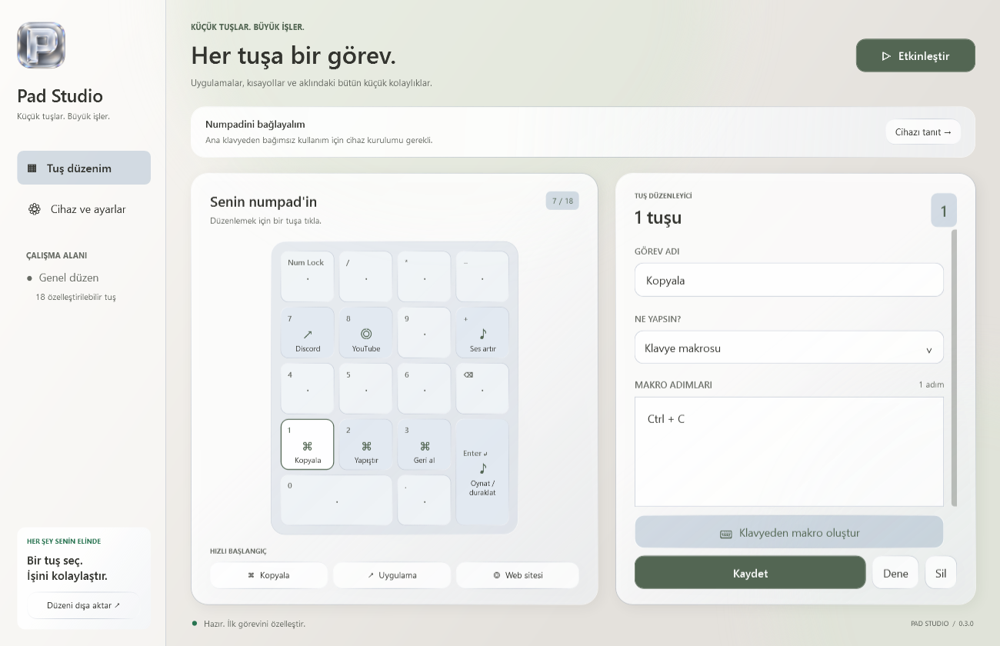
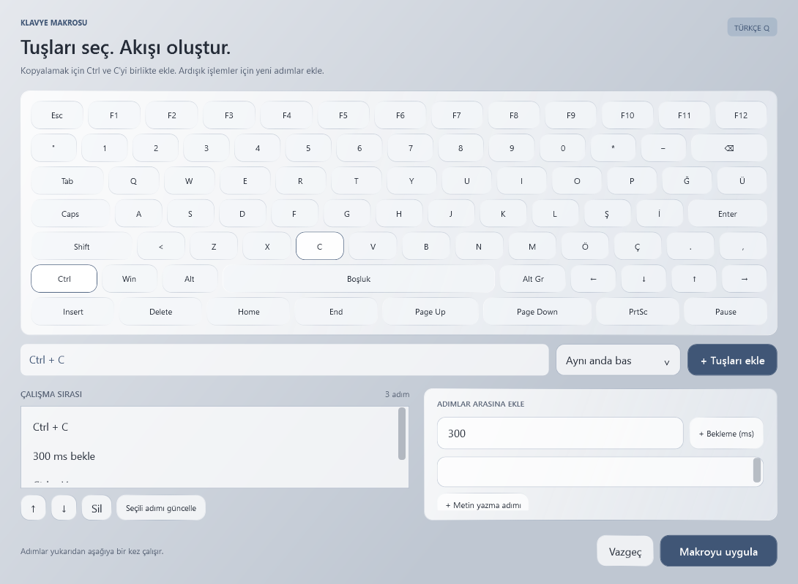
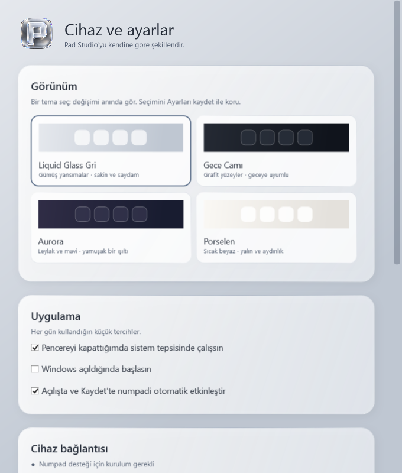
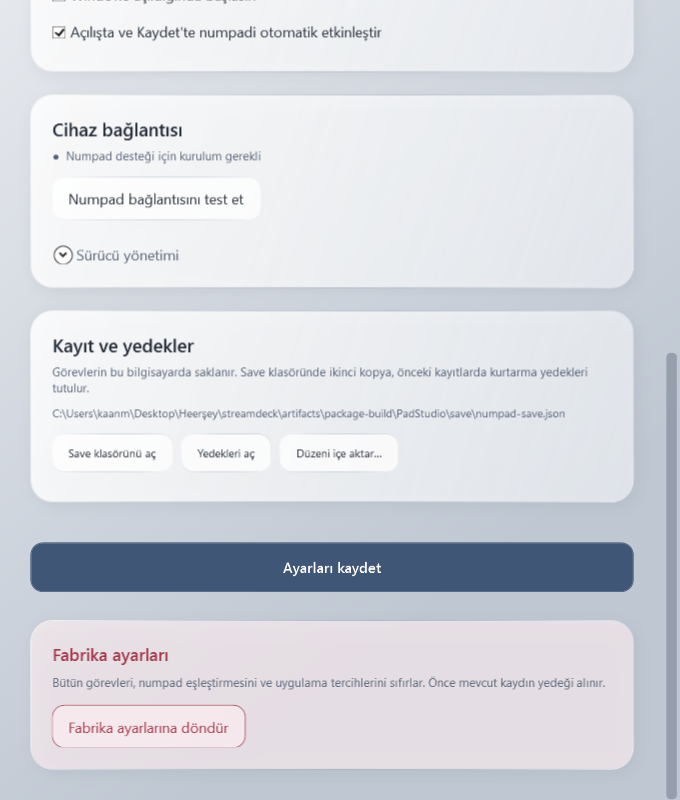
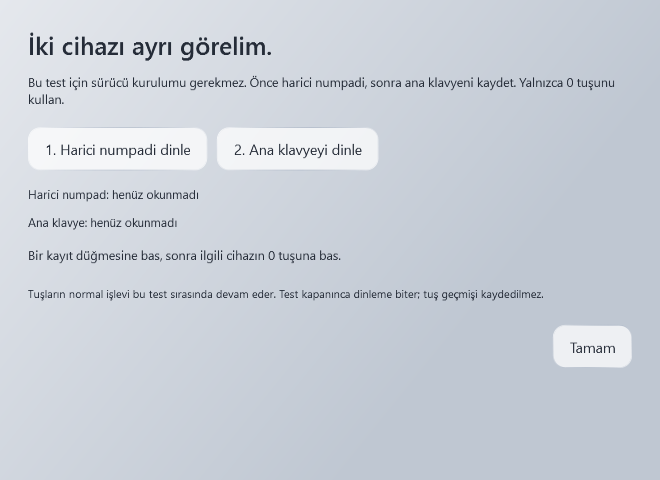

# Pad Studio ekran görüntüleri

Görüntüler v0.3.0 uygulamasının gerçek WPF arayüzünden `--render` önizleme moduyla üretildi. Görevler örnek veridir; kişisel ayarlar kullanılmadı. Görüntüler fiziksel cihaz bağlantısı veya sürücü uyumluluğu testi değildir.

## Liquid Glass Gri

## Gece Camı

## Aurora

## Porselen

## Makro düzenleyicisi

## Cihaz ve ayarlar

## Kurtarma ve fabrika ayarları

## Numpad bağlantı testi

